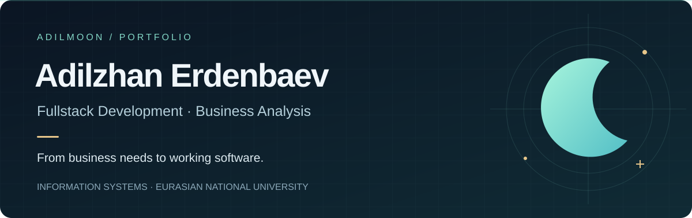
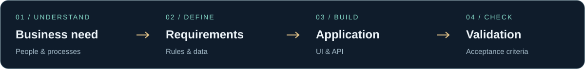

  

  <strong>English</strong> · <a href="README.md">Русский</a> 
  <a href="https://github.com/AdilMoon/DentLux">Featured project</a> ·
  <a href="docs/dentlux-case-study.md">Business analysis case</a> ·
  <a href="https://github.com/AdilMoon?tab=repositories">All repositories</a>

## 👋 Hi, I'm Adilzhan

Information Systems student at **Eurasian National University**, building a portfolio at the intersection of **fullstack development** and **business analysis**.

I'm interested in how a business process becomes a clear requirement, a usable interface, and a working application. I'm looking for opportunities to grow in fullstack development and business analysis.

## Selected projects

### 01 / DentLux

**Dental clinic management · Fullstack web application**

A project covering patient, doctor, and administrator workflows. The repository includes appointment management, payment and refund models, medical records, and deployment configuration.

| Perspective | What to explore |
| :--- | :--- |
| Product | Separate interfaces for patients, doctors, and administrators |
| Frontend | React, TypeScript, Vite, Tailwind CSS |
| Backend | Node.js, Express, PostgreSQL, Prisma |
| Delivery | Docker Compose; Terraform and Ansible configuration |
| Business analysis | Actors, appointment lifecycle, business rules, and example acceptance criteria |

[Explore the code ↗](https://github.com/AdilMoon/DentLux) · [Read the business case ↗](docs/dentlux-case-study.md) · [View the data model ↗](https://github.com/AdilMoon/DentLux/blob/main/backend/prisma/schema.prisma)

### 02 / HopeStep

**Language learning · Android application**

An Android language-learning project using Kotlin, Jetpack Compose, and Room. A complementary project showing experience beyond web applications.

[Explore the code ↗](https://github.com/AdilMoon/HopeStep) · [View the Android setup ↗](https://github.com/AdilMoon/HopeStep/blob/main/app/build.gradle.kts)

## 💻 Technologies in my projects

  &nbsp;&nbsp;
  &nbsp;&nbsp;
  &nbsp;&nbsp;
  &nbsp;&nbsp;
  &nbsp;&nbsp;
  &nbsp;&nbsp;
  &nbsp;&nbsp;

**Tools & delivery**

  &nbsp;&nbsp;
  &nbsp;&nbsp;
  &nbsp;&nbsp;

**Mobile development**

  &nbsp;&nbsp;
  &nbsp;&nbsp;

| Web interfaces | APIs & data | Delivery | Mobile |
| :--- | :--- | :--- | :--- |
| React · TypeScript | Node.js · Express | Git · Docker | Kotlin |
| Tailwind CSS · Vite | PostgreSQL · Prisma | Terraform · Ansible | Jetpack Compose · Room |

## Business analysis focus

I'm developing my ability to connect business needs with implementation through **process modelling, requirements, data models, and acceptance criteria**. The [DentLux case study](docs/dentlux-case-study.md) is a retrospective portfolio exercise based on the repository, with proposed requirements clearly separated from verified implementation details.

---

  <strong>Interested in fullstack development and business analysis opportunities.</strong> 
  <a href="https://github.com/AdilMoon">@AdilMoon</a> · <a href="README.md">Читать на русском</a>

