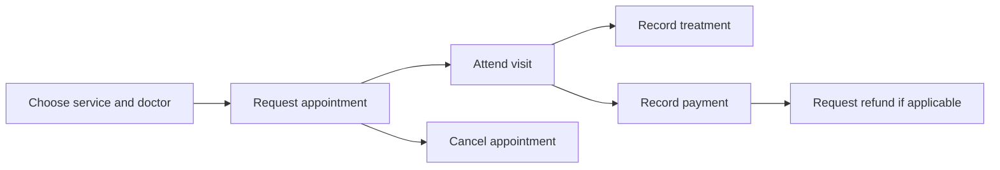

# DentLux / Business analysis case

[← Profile](../README.md) · [Русский ↓](#русский) · [Project repository ↗](https://github.com/AdilMoon/DentLux)

> **Portfolio exercise.** This is a retrospective analysis of the public repository, not a record of stakeholder interviews or a commercial engagement. Proposed requirements and metrics below need validation. No measured business impact is claimed.

## 1. Business context

A dental clinic needs to coordinate appointments, clinical work, and financial records. DentLux provides a useful setting for exploring how different actors interact with the same appointment.

| Actor | Need to investigate | Repository evidence |
| :--- | :--- | :--- |
| Patient | Arrange and track a visit | Client dashboard; appointments linked to a client |
| Doctor | View assigned visits and record treatment | Doctor dashboard; doctor relations and medical records |
| Administrator | Coordinate operations and financial records | Admin dashboard; payment, refund, expense, and audit models |

The needs are analysis hypotheses. The referenced interfaces and models are present in the repository; their presence alone does not prove complete runtime behaviour.

## 2. Process to validate

This is a proposed business flow, not an assertion that every transition is implemented. Treatment and payment ordering, cancellation rules, and refund eligibility require stakeholder agreement.

## 3. Traceability: need → requirement → evidence

| Need | Proposed requirement | Existing evidence / next validation |
| :--- | :--- | :--- |
| Prevent overlapping visits | Reject overlapping active appointments for the same doctor | Appointment date/time and service duration exist. Inspect booking logic and test concurrent requests. |
| Separate responsibilities | Restrict each role to authorised actions and records | CLIENT, DOCTOR, ADMIN roles exist. Verify permissions per endpoint. |
| Track a visit's financial state | Make payment and refund statuses explicit | Payment and Refund models exist. Agree settlement and refund rules. |
| Explain administrative changes | Record who changed a record and when | AuditLog model exists. Verify coverage and visibility rules. |

## 4. Example acceptance criteria — proposed

**Story:** As a patient, I want to book an available appointment so that I can plan a clinic visit.

- **Given** an active service and an available doctor, **when** valid booking details are submitted, **then** the system creates one appointment and returns its identifier and initial status.
- **Given** an overlapping active appointment for the same doctor, **when** another booking is submitted, **then** the system rejects it and explains the conflict.
- **Given** two concurrent requests for the same slot, **when** they are processed, **then** at most one appointment is accepted.
- **Given** a patient account, **when** it requests another patient's appointment, **then** access is denied.

These are examples for future validation, not test results.

## 5. Questions before implementation

1. Which roles may create, reschedule, cancel, and complete an appointment?
2. How are service duration, breaks, doctor availability, and clinic time zone handled?
3. Which appointment statuses are canonical? The schema includes VISITED, COMPLETED, and DONE; their meanings and allowed transitions need clarification.
4. When is a refund eligible, who approves it, and how are partial refunds handled?
5. Which records must be retained, and who may view or amend them?

## 6. Candidate success measures

| Measure | Proposed definition |
| :--- | :--- |
| Booking completion | Completed booking submissions / started booking journeys |
| No-show rate | Missed appointments / appointments scheduled to occur in the period |
| Scheduling conflicts | Confirmed overlapping appointments per doctor per period |

Baselines, event instrumentation, status definitions, and targets have not been established. These are proposed measures, not achieved results.

## Evidence

- [Application overview and deployment configuration](https://github.com/AdilMoon/DentLux/blob/main/README.md)
- [Data model, roles, and statuses](https://github.com/AdilMoon/DentLux/blob/main/backend/prisma/schema.prisma)
- [Frontend pages](https://github.com/AdilMoon/DentLux/tree/main/frontend/src/pages)
- [Frontend technologies](https://github.com/AdilMoon/DentLux/blob/main/frontend/package.json) · [Backend technologies](https://github.com/AdilMoon/DentLux/blob/main/backend/package.json)

---

## Русский

### Контекст и границы кейса

Это **ретроспективный учебный разбор** публичного репозитория DentLux. Он не описывает интервью с заказчиком или коммерческий опыт. Требования и метрики ниже предлагаются для проверки; измеренные бизнес-результаты не заявляются.

Клинике необходимо согласовывать записи на приём, работу врачей и финансовые операции. В проекте есть интерфейсы пациента, врача и администратора, а в модели данных — записи на приём, медицинские записи, платежи, возвраты, расходы и журнал действий.

### Участники и предполагаемые потребности

| Участник | Потребность для проверки | Основание в репозитории |
| :--- | :--- | :--- |
| Пациент | Записаться на приём и отслеживать визит | Кабинет клиента, связь записи с пациентом |
| Врач | Видеть свои приёмы и фиксировать лечение | Кабинет врача, медицинские записи |
| Администратор | Координировать работу и финансовый учёт | Кабинет администратора, платежи, возвраты, расходы, аудит |

Наличие интерфейса или модели не подтверждает полноту работающего сценария. Потребности участников требуют проверки.

### Предлагаемый процесс

Выбор услуги и врача → запрос записи → визит → фиксация лечения и оплаты. Дополнительные ветки: отмена записи и запрос возврата. Порядок лечения и оплаты, правила отмены и основания для возврата нужно согласовать.

### Связь потребности с требованиями

| Потребность | Предлагаемое требование | Что проверить |
| :--- | :--- | :--- |
| Избежать пересечения приёмов | Отклонять пересекающиеся активные записи одного врача | Логику бронирования, длительность услуги и конкурентные запросы |
| Разделить ответственность | Ограничить доступ действиями и данными своей роли | Проверки прав каждого API-метода |
| Отслеживать расчёты | Явно учитывать статусы платежа и возврата | Правила оплаты, частичных возвратов и согласования |
| Объяснять изменения | Фиксировать автора и время изменения | Полноту записей AuditLog и права просмотра |

### Пример user story и критериев приёмки

**История:** Как пациент, я хочу записаться на свободное время, чтобы спланировать визит в клинику.

- Если услуга активна, врач доступен, а данные корректны, система создаёт одну запись и возвращает её идентификатор и начальный статус.
- Если время пересекается с другой активной записью этого врача, система отклоняет запрос и объясняет конфликт.
- При двух одновременных запросах на один слот система принимает не более одной записи.
- Пациент не может получить доступ к чужой записи.

Это предлагаемые критерии для будущей проверки, а не результаты выполненных тестов.

### Открытые вопросы

1. Кто может создавать, переносить, отменять и завершать запись?
2. Как учитываются длительность услуги, перерывы, график врача и часовой пояс клиники?
3. Чем различаются VISITED, COMPLETED и DONE в текущей схеме? Какие переходы допустимы?
4. Кто согласовывает возврат и как обрабатываются частичные возвраты?
5. Какие записи нужно хранить и кто вправе их просматривать и изменять?

### Предлагаемые метрики

| Метрика | Определение для согласования |
| :--- | :--- |
| Конверсия записи | Завершённые отправки заявки / начатые сценарии записи |
| Доля неявок | Пропущенные приёмы / приёмы, назначенные на рассматриваемый период |
| Конфликты расписания | Число подтверждённых пересечений записей одного врача за период |

Исходные значения, сбор событий, определения статусов и цели пока не установлены. Основания для разбора приведены в разделе [Evidence](#evidence).

[← Вернуться к профилю](../README.ru.md)
